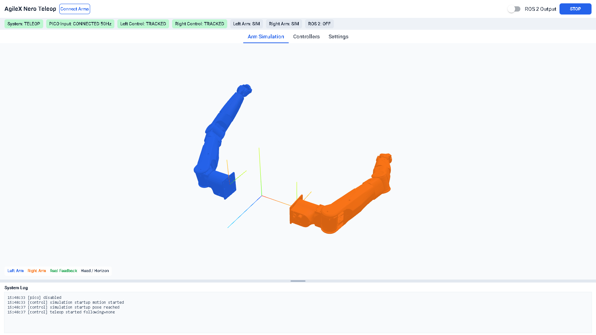

# AgileX Nero Teleop

PICO 4 Ultra controller teleoperation for AgileX Nero arms.

The repository contains:

- a PICO headset receiver with ADB setup
- a two-process teleoperation controller
- analytic seven-axis inverse kinematics
- a NiceGUI web console
- a URDF/STL-based dual-arm simulation
- optional ROS 2 publishing
- the PICO APK sources and prebuilt APK

## System Architecture

The application runs as two Python processes:

```text
python run.py
├── parent process
│   ├── NiceGUI web console
│   ├── ArmController thread
│   ├── simulation state
│   ├── real-arm backends
│   └── optional ROS 2 publisher
└── pico_bridge child process
    ├── ADB reverse and APK launch
    ├── PICO TCP receiver
    └── local IPC server
```

Data flow:

```text
PICO APK
  │ TCP 29761
  ▼
adb reverse
  ▼
pico_bridge
  │ NDJSON over 127.0.0.1:9101
  ▼
IpcPoseSource
  ▼
ArmController ──► simulation q ──► NiceGUI 3D scene
      │
      ├──► RealArmBackend (left/right, SocketCAN)
      └──► RosOutput (/nero/left/*, /nero/right/*)
```

The GUI and controller share an immutable snapshot and a command queue. The
PICO bridge is a separate process so headset reconnects and ADB failures do not
block the UI or the controller.

## Requirements

- Python 3.12 recommended
- Linux or Windows for real Nero arms
  - Linux uses SocketCAN, Windows uses the AgileX `agx_cando` adapter
- Windows or Linux for simulation, GUI, and PICO bridge
- PICO 4 Ultra with the supplied APK installed
- USB debugging enabled and authorized
- `adb` from Android Platform-Tools (see [Install adb](#install-adb))
- Cython and a C/C++ compiler
  - Visual Studio Build Tools with the C++ workload on Windows
  - a C compiler such as GCC on Linux

## Installation

Use an existing conda environment. Do not create a new environment. The
following examples assume the existing environment is named `mmhand`; replace it
with the environment you already use.

The environment must already provide Python 3.12 and, for ROS 2 output, the
ROS 2 Python packages (`rclpy`, `geometry_msgs`, `std_msgs`). If those packages
are missing, install them into the same environment with conda; do not clone the
environment.

### Install Python dependencies

```bash
conda activate mmhand
pip install -r requirements.txt
```

`requirements.txt` installs the project dependencies into the active conda
environment. It does not create an environment.

### Build the IK extension

The IK solver is the only compiled part of the project. Cython generates C from
`ik_solver.pyx`, then the platform compiler builds a native extension.

Windows and Linux use the same commands. The only difference is the compiler
environment:

- Windows: open **x64 Native Tools Command Prompt for VS 2022** so `cl.exe` is
  on `PATH`.
- Linux: a working GCC toolchain.

```bash
conda activate mmhand
cd <repository>
python setup.py build_ext --inplace
```

Expected build artifacts:

```text
ik_solver.c
ik_solver.cp312-win_amd64.pyd   # Windows
ik_solver.cpython-312-*.so      # Linux
```

The generated files are ignored by Git. Rebuild after changing `ik_solver.pyx`.
If Cython is missing, run `pip install -r requirements.txt` in the same
environment.

For real-arm use, initialize the SDK submodule:

```bash
git submodule update --init --recursive
```

Real arms run on both platforms: SocketCAN (`can0`, `can1`, ...) on Linux and
the AgileX `agx_cando` adapter (`0`, `1`, ...) on Windows. `RealArmConfig`
selects the backend and channel from the platform, and the `Connect Arms` rows
pre-fill them; override the channel there if the wiring differs. On Windows the
vendor `python-can-agx-cando` plugin (a `python-can` backend wrapping
`cando.dll`) must also be installed; it is not on PyPI and ships with the
AgileX CAN adapter package.

### Install the CAN bring-up/recovery unit (Linux, once per machine)

One-time root setup that keeps `can0`/`can1` usable across replugs, reboots,
and CAN-cable pulls:

```bash
sudo bash scripts/can0-persist/install.sh
```

It installs one systemd unit per channel (brings the interface up whenever the
USB adapter appears) plus the passwordless-sudo rule that lets `hardware.py`
bounce a wedged interface automatically during connect. Re-running it is safe.
Without it everything still works, but recovering from a pulled CAN cable needs
the manual `sudo systemctl restart can0.service` command.

### Install adb

`pip install` does not provide adb; install Android Platform-Tools once.

- Windows: unzip `platform-tools-latest-windows.zip` into
  `%LOCALAPPDATA%\Android\Sdk\platform-tools` (or add its folder to `PATH`).
- Linux: `sudo apt install android-tools-adb`.

Verify with `adb devices`; the headset must appear as `device` (accept the USB
debugging prompt in the headset if it shows `unauthorized`).

If adb is already installed elsewhere, set `PicoConfig.adb_path` in `config.py`.
Lookup order: `adb_path`, `%LOCALAPPDATA%\Android\Sdk\platform-tools\adb.exe`,
`PATH`, `~/Android/Sdk/platform-tools`.

### PICO APK

Install the prebuilt APK:

```bash
adb install -r apk/generated_apk/pico_head_relative_pose.apk
```

The `pico_bridge` process runs `adb reverse` and launches the APK automatically.

## Running

```bash
python run.py
```

The GUI opens at `http://127.0.0.1:8080`, or on the next free port.

Options:

```text
--no-pico          do not start the PICO bridge
--demo             use synthetic controller motion; implies --no-pico
--headless         run the controller without NiceGUI
--duration SEC     headless run time
--port PORT        GUI port
--vr-port PORT     PICO TCP port on the PC
--ipc-port PORT    PICO bridge IPC port
--no-browser       do not open a browser
```

Examples:

```bash
python run.py
python run.py --no-pico --demo
python run.py --no-pico --headless --duration 5
```

## GUI

Top bar:

- `AgileX Nero Teleop`
- `Connect Arms`
- `ROS 2 Output` switch
- `STOP` while running; after STOP it is replaced by `Start`

The status bar contains colored chips for:

- system phase
- PICO input
- left/right controller tracking
- left/right arm state
- ROS 2 output

Tabs:

- `Arm Simulation` (first tab and default): full-width 3D view of both arms
- `Controllers`: live pose and button state for both PICO controllers
- `Settings`: startup pose and arm base frame overrides

The bottom `System Log` is resizable. Drag the divider to change its height.



## Settings

`Settings` edits a runtime override file:

```text
settings.json
```

It does not rewrite `config.py`. `config.py` remains the source of default
values. The file is ignored by Git.

Editable fields:

- left and right startup pose, seven joint angles in degrees
- horizon-to-shoulder translation for each arm
- shoulder-to-arm-base translation and RPY for each arm

Buttons:

- `Apply`: validate, write `settings.json`, and apply immediately
- `Restore Defaults`: remove `settings.json`, restore the displayed defaults, and apply immediately

Settings are applied without restarting the process. Base-frame changes update
the running controller and the 3D scene immediately. Startup-pose changes are
stored immediately, but the arms move to that pose on the next START or after
`STOP` → `Reset`, because it is a pose target rather than a live override.

If `settings.json` is missing or invalid, the application logs a warning and
uses the `config.py` defaults.

## Operating the Arms

### Connecting arms

`Connect Arms` opens independent left and right rows. Each row has its own CAN
channel and `Connect` / `Disconnect` button.

- No arm connected: pure simulation
- Left only: left arm uses hardware, right arm remains simulated
- Right only: right arm uses hardware, left arm remains simulated
- Both: both arms use hardware

Left and right must use different CAN channels.

A successful connection latches STOP: the simulation and every connected arm
hold until you press `Start`.

### STOP and Start

`STOP` is a latched emergency stop. It stops new targets, keeps all connected
arms at their current joint positions, and disables further control. After STOP,
the `STOP` button is replaced by `Start`.

`Start` asks for confirmation and then:

- returns the simulation to the startup pose
- moves every connected real arm to the startup pose, enters servo hold, and
  resumes teleoperation
- when real arms are connected, requires the operator to confirm that each
  simulated arm base matches its real arm base before anything moves

For pure simulation, `Start` returns directly to teleoperation after the startup
pose. A `FAULT` is not cleared by `Start`; restart the process after a fault.

### Logging

Runtime messages go to the console, the GUI `System Log`, and a rotating file:

```text
logs/control.log
```

The file log is enabled by `LogConfig.enabled`. The GUI log is resizable and
shows control and PICO bridge events.

### ROS 2 output

The switch is off by default. When enabled, the PICO bridge publishes the input
topics and the controller publishes the arm topics:

```text
/read_pose/poses
/read_pose/buttons
/read_pose/tracked

/nero/left/current_joint_angles_deg
/nero/left/target_joint_angles_deg
/nero/left/current_end_effector_pose
/nero/left/target_end_effector_pose

/nero/right/current_joint_angles_deg
/nero/right/target_joint_angles_deg
/nero/right/current_end_effector_pose
/nero/right/target_end_effector_pose
```

Joint values are in degrees. End-effector poses are `geometry_msgs/PoseStamped`
in `pose_input_horizon`.

## How It Works

### PICO input

The APK sends one CSV line per controller sample:

```text
timestamp,left_valid,lx,ly,lz,lqx,lqy,lqz,lqw,
right_valid,rx,ry,rz,rqx,rqy,rqz,rqw,left_buttons,right_buttons
```

Poses are expressed in a gravity-aligned horizon frame:

```text
+X = right
+Y = up
-Z = forward
origin = head position
orientation = yaw only
```

### IPC

The PICO bridge and controller communicate over a local TCP connection:

- NDJSON, one message per line
- `pico_frame` for controller samples
- `pico_status` for ADB and frame-rate state
- `command` / `command_ack` for ROS output and shutdown
- latest-frame semantics for high-rate input

### Analytic IK

`ik_solver.pyx` solves a seven-axis Nero arm from an end-effector pose:

1. Sample the redundant arm angle `theta0`.
2. Solve joints 1-4 geometrically from the elbow position.
3. Extract joints 5-7 from the remaining wrist transform.
4. Discard candidates outside joint limits.
5. Score candidates by joint continuity, pose error, arm-angle change, and
   joint-limit proximity.

`ik.py` converts the flange target to the link-7 frame using the URDF
`gripper_flange_joint` origin.

### URDF mesh simulation

The simulation uses the real Nero URDF and STL meshes:

```text
nero_urdf/nero.urdf
nero_urdf/meshes/*.stl
```

`ui/scene.py` parses the URDF joint tree:

- joint parent and child links
- joint origin `xyz` and `rpy` (URDF `rpy` is in radians)
- joint axis
- visual mesh and visual origin

Each joint is represented by a fixed origin group and a rotating group. Only
the seven joint rotations are updated during teleoperation. The STL meshes are
served by NiceGUI at `/nero_meshes/*.stl`.

The scene also shows the `pose_input_horizon` frame as RGB axes at the scene
origin. Red is horizon +X, green is horizon +Y, and blue is horizon +Z. The
camera is positioned close to the arms so both arms fill the viewport.

The left arm is blue, the right arm is orange, and real-arm feedback is drawn as
a semi-transparent green ghost.

### Filtering and motion limits

The controller applies:

- OneEuro pose filtering
- input position and rotation limiting
- IK output filtering
- joint velocity, acceleration, and per-tick step limits
- joint-limit margin clipping

### Simulation and real arms

Both sides always maintain a simulated joint state. A connected side also sends
the same target to its real arm. When no PICO pose is available, that side holds
its current target. After `Start`, real arms move to the startup pose, enter
servo hold, and then follow the teleoperation targets.

## Code Structure and Line Counts

Line counts are total file lines, including blank lines and comments.

```text
analytic_control/
├── run.py                              183
├── config.py                           177
├── control_loop.py                     494
├── controller_state.py                  66
├── settings_store.py                    93
├── ipc.py                              238
├── pose_source.py                      147
├── ros_output.py                       131
├── hardware.py                         404
├── ik.py                                73
├── ik_solver.pyx                       605
├── filters.py                          149
├── frames.py                            85
├── motion.py                            90
├── transforms.py                        67
├── joint_feedback.py                    30
├── logging_utils.py                     73
├── read_joints.py                       21
├── setup.py                             21
│
├── pico_bridge/
│   ├── __init__.py                       0
│   ├── __main__.py                      65
│   ├── bridge.py                       274
│   └── ros_output.py                    85
│
├── ui/
│   ├── __init__.py                       0
│   ├── app.py                          295
│   ├── controllers.py                   66
│   ├── scene.py                        315
│   └── settings.py                      94
│
├── test/
│   ├── __init__.py                       0
│   ├── test_controller.py              184
│   ├── test_hardware.py                349
│   ├── test_ipc.py                      65
│   ├── test_kinematics.py              149
│   ├── test_logging.py                  42
│   ├── test_pico_bridge.py              92
│   ├── test_ros_output.py               76
│   ├── test_settings.py                 63
│   └── test_ui.py                      161
│
├── requirements.txt
├── pytest.ini                             4
├── settings.json                          # generated, ignored by Git
└── README.md
```

Source code totals, excluding this README, requirements, and pytest.ini:

| Group | Files | Lines |
|---|---:|---:|
| Core control and kinematics | 17 | 3,105 |
| PICO bridge | 4 | 424 |
| NiceGUI | 5 | 770 |
| Tests | 10 | 1,181 |
| Setup | 1 | 21 |
| Hardware debug tool | 1 | 21 |
| **Total** | **38** | **5,522** |

`nero_urdf/meshes/*.stl` are runtime assets, not code. `apk/`, `build/`,
generated `.pyd`/`.c` files, and `logs/` are excluded from the code count.

## Testing

```bash
pytest -q
```

Tests live in `test/`. `pytest.ini` sets:

```ini
testpaths = test
pythonpath = .
asyncio_mode = auto
```

Coverage includes:

- analytic IK and motion limits
- URDF chain versus analytic forward kinematics
- real-arm feedback and motion behavior
- two-process IPC
- PICO bridge helpers
- ROS 2 topic payloads
- dual-arm connection, STOP and Start behavior
- English UI, status colors, System Log, and Start dialog
- file and in-memory logging

## Troubleshooting

- `ik_solver` import fails: build it with
  `python setup.py build_ext --inplace`.
- `ModuleNotFoundError: No module named 'Cython'`: activate the existing
  environment and run `pip install -r requirements.txt`, then build again.
- Windows build cannot find `cl.exe`: use an x64 Native Tools Command Prompt for
  VS 2022.
- `ADB setup failed: adb not found`: install Android Platform-Tools or set
  `PicoConfig.adb_path` (see [Install adb](#install-adb)).
- PICO not found: check `adb devices`, USB debugging, and the APK package. The
  bridge retries ADB automatically.
- PICO controllers stay `LOST` while `PICO Input` is `CONNECTED`: a PICO system
  overlay takes input focus away from the app. Two windows do this — the
  `HandDialogActivity` prompt, which opens on its own virtual display, and
  `PicoXR_CustomDialog`, which is what actually covers the VR view. Neither
  answers BACK, and `am start` is a no-op because the app is already the top
  instance, so `pico_bridge` watches `mCurrentFocus` every 0.5 s and force-stops
  the overlay package (`PicoConfig.focus_guard`, `overlay_package`) when one of
  them appears; it re-reads focus afterwards and logs whether the app recovered.
  Do not disable hand tracking system-wide: on some PICO builds it also disables
  the controllers.
- Disabling the dialog outright is not always possible: on the tested PICO build
  `pm disable-user` for the component fails with
  `SecurityException: Shell cannot change component state`, so the focus guard is
  the only path. Check what currently holds focus with:
  ```powershell
  adb shell "dumpsys window | grep mCurrentFocus"
  ```
- Real arm connection fails: verify the CAN channel and bitrate. Linux expects a
  SocketCAN interface such as `can0`; Windows expects an `agx_cando` device index
  such as `0`. On Windows, check that the USB-CAN adapter is plugged in and that
  `python-can-agx-cando` is installed.
- The arm connects but stays silent (`candump can0` shows nothing): Nero firmware
  at or below 1.11 only streams feedback after CAN push is enabled with
  `set_normal_mode()`. Firmware auto-detection now sends that request itself, so a
  freshly power-cycled arm needs no manual step; if it still stays silent, enable
  CAN push in the vendor web UI or set `RealArmConfig.firmware` explicitly.
  Push requests must stay at least ~100 ms apart: two `set_normal_mode()` calls in
  a row disable push again on this firmware, so the connect path spaces them and
  re-arms when the stream stops. A mid-run stall (green feedback ghost frozen at
  an old pose) is now re-requested automatically instead of staying stale.
- `SocketCAN interface 'can0' entered ERROR-PASSIVE` right after power-up: the arm
  does not acknowledge frames until its controller has booted, so the interface
  drops into passive error state for a few seconds. Transient faults are retried
  for `RealArmConfig.can_fault_grace_s` seconds; a fault that outlasts that points
  at wiring, bitrate, or missing 24 V power.
- The same ERROR-PASSIVE error after unplugging and replugging the CAN cable: the
  gs_usb adapter wedges in ERROR-PASSIVE/BUS-OFF while the cable is out (frames
  get no ACK) and never recovers by itself — this adapter rejects `restart-ms`
  ("Device doesn't support restart from Bus Off"), and replugging the bus cable
  does not re-run `can0.service` because the USB device never disappeared. After
  the one-time setup (`sudo bash scripts/can0-persist/install.sh`, see
  [Installation](#install-the-can-bring-uprecovery-unit-linux-once-per-machine)),
  `ensure_socketcan_ready()` bounces the unit automatically whenever a connect
  attempt finds the interface wedged, so replugging no longer requires
  restarting the terminal. Manual fallback: `sudo systemctl restart can0.service`.
- Port already in use: `run.py` selects the next free port; pass `--port`,
  `--vr-port`, or `--ipc-port` explicitly if needed.
- ROS 2 output says `UNAVAILABLE`: the active environment needs `rclpy`,
  `geometry_msgs`, and `std_msgs`. Install them into the same environment with
  conda, then toggle again:
  ```bash
  conda install -c conda-forge -c robostack-jazzy \
    ros-jazzy-ros-base ros-jazzy-geometry-msgs ros-jazzy-std-msgs
  ```
- NumPy matrix operations crash with a DLL or OpenBLAS error: reinstall NumPy
  into the same environment:
  ```bash
  python -m pip install --force-reinstall --no-cache-dir "numpy>=1.26"
  ```
